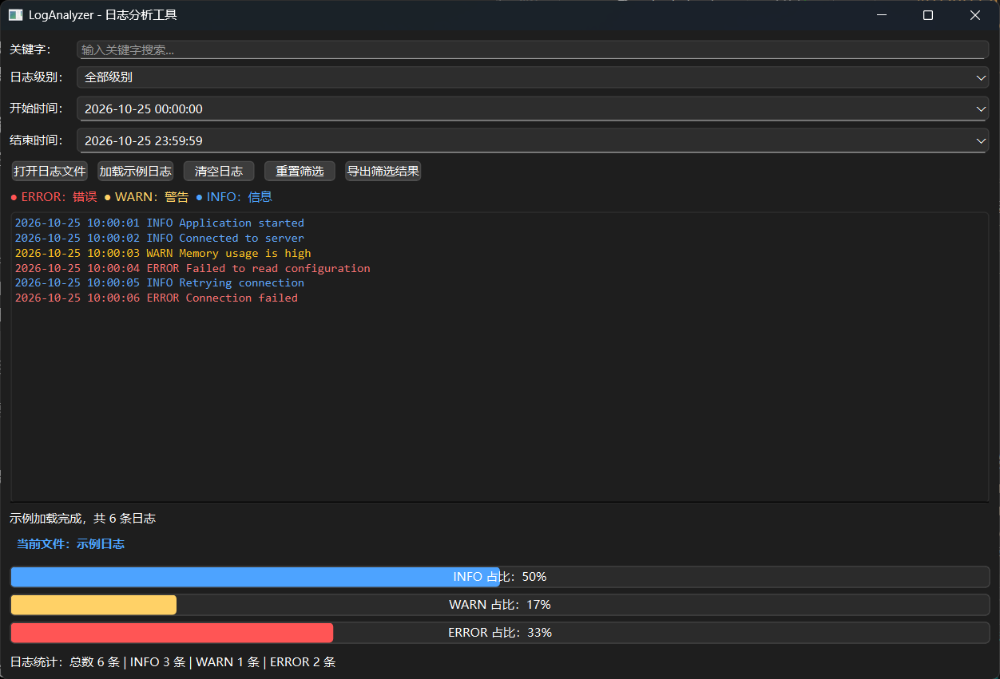

\# LogAnalyzer —— 基于 Qt 6 的日志分析工具


\## 一、项目简介


LogAnalyzer 是一个基于 \*\*Qt 6、C++17 和 CMake\*\* 开发的桌面日志分析工具，采用 Qt Widgets 构建图形用户界面。


本项目用于读取、展示、筛选和导出日志文件，帮助用户快速定位日志中的异常信息。

### 运行截图



\## 二、主要功能


\- \*\*日志文件读取\*\*：支持打开本地日志文件，并显示当前加载的文件名。

\- \*\*示例日志加载\*\*：提供示例日志，方便快速体验程序功能。

\- \*\*日志分类显示\*\*：区分 INFO、WARN 和 ERROR 三种日志级别，并使用不同颜色显示。

\- \*\*关键词搜索\*\*：根据输入的关键词筛选日志。

\- \*\*级别筛选\*\*：根据日志级别过滤日志信息。

\- \*\*时间范围筛选\*\*：支持按照起止时间筛选日志。

\- \*\*实时统计\*\*：统计筛选结果中的日志总数及各级别数量。

\- \*\*比例可视化\*\*：通过进度条展示不同级别日志所占比例。

\- \*\*结果导出\*\*：支持将当前筛选结果导出为 TXT 文件。

\- \*\*异步读取\*\*：使用 QtConcurrent 在后台读取日志，减少文件读取对界面响应的影响。

\## 三、开发环境


| 项目 | 说明 |

|---|---|

| 开发语言 | C++17 |

| 图形界面框架 | Qt 6 Widgets |

| 并发处理 | QtConcurrent |

| 构建工具 | CMake |

| 开发环境 | Qt Creator |

| 编译器 | MinGW 64-bit |


\## 四、涉及的技术点


1\. Qt Widgets 界面布局与控件使用。

2\. 信号与槽机制，实现按钮操作及筛选条件联动。

3\. QFile、QFileDialog 实现文件读取、保存及路径选择。

4\. QString、QStringList 进行日志文本处理。

5\. QDateTime 解析日志时间并实现时间范围筛选。

6\. QtConcurrent 与 QFutureWatcher 实现异步日志读取及任务完成后的界面更新。

7\. QProgressBar 实现日志级别占比展示。

8\. CMake 管理项目构建与依赖。


\## 五、项目运行方法


\### 1. 环境准备


安装 Qt 6、Qt Creator、MinGW 64-bit 编译器和 CMake。


\### 2. 打开项目


1\. 启动 Qt Creator。

2\. 选择“打开文件或项目”。

3\. 选择项目根目录下的 `CMakeLists.txt`。

4\. 选择已安装的 Qt 6 MinGW 64-bit Kit。

5\. 等待 CMake 配置完成。


\### 3. 编译与运行


1\. 点击 Qt Creator 中的构建按钮，编译项目。

2\. 编译成功后，点击运行按钮启动程序。

3\. 可以点击“加载示例日志”体验日志筛选、统计和导出功能。


\## 六、项目目录结构


```text

LogAnalyzer/

├── CMakeLists.txt

├── main.cpp

├── mainwindow.h

├── mainwindow.cpp

└── README.md

```


\- `CMakeLists.txt`：项目构建配置及 Qt 模块依赖。

\- `main.cpp`：程序入口。

\- `mainwindow.h`：主窗口类声明及成员变量定义。

\- `mainwindow.cpp`：界面布局、日志读取、筛选、统计和导出等功能实现。

\- `README.md`：项目介绍、功能说明和运行文档。


\## 七、项目总结


通过本项目，实践了 Qt Widgets 桌面应用开发、日志文本处理、条件筛选、数据统计、文件操作以及异步任务处理等内容。


后续可继续完善异常处理、日志格式兼容性、超大文件读取效率和单元测试等功能。


